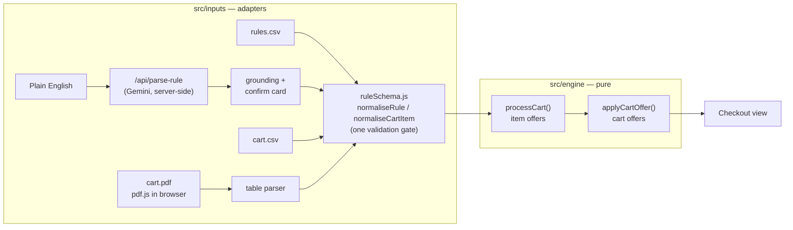

# Opptra Discount Engine — FDE Intern Assignment

**Live demo:** https://discount-engine-assignment-pi.vercel.app  ·  

A customer-facing cart pricing engine. It picks the biggest saving per item, stacks stackable offers, applies cart-level offers, and explains every price in plain language. Offers can come from a CSV or from plain English (parsed by an LLM). Carts can come from a CSV or a PDF.

## Run locally (3 steps)

```bash
npm install
cp .env.example .env        # paste a free GEMINI_API_KEY from aistudio.google.com/apikey (only needed for plain-English offers)
npm run dev                 # http://localhost:5173 → click "Load sample data"
```

`npm test` runs 41 tests and needs no API key. `npm run eval:llm` runs the LLM eval (below).

## What was built

| Task | Where |
|---|---|
| Foundation: engine verified against the brief (ITEM-01…06, Rs.5,932 → Rs.5,339) | `src/engine/discountEngine.js`, `test/engine.test.js` |
| Task 1: cart-level offers (`scope: cart`, `min_cart_value`) | `applyCartOffer()`; `CartSummary.jsx` shows the cart-offer line, or progress towards the threshold |
| Task 2: plain English → LLM → validation → confirm/discard → engine re-runs | `server/parseRule.js`, `api/parse-rule.js`, `src/inputs/nlRuleInput.js`, `RuleComposer.jsx` |
| Task 3: PDF cart → replaces cart → engine re-runs | `src/inputs/cartTableParser.js`, `src/inputs/pdfCartInput.js` |

### Expected results (asserted in `test/engine.test.js`)

| Item | Base | Applied | Final | Status |
|---|---|---|---|---|
| ITEM-01 | Rs.1,299 | RULE-01 (Rs.195) beats RULE-02 (Rs.150) | **Rs.1,104** | Best offer picked |
| ITEM-02 | Rs.849 | RULE-02 −Rs.150, then RULE-03 −10% | **Rs.629** | Stacked |
| ITEM-03 | Rs.599 | RULE-01 15% | **Rs.509** | Discount applied |
| ITEM-04 | Rs.2,499 | none | **Rs.2,499** | No offer |
| ITEM-05 | Rs.449 | RULE-01 15% | **Rs.382** | Discount applied |
| ITEM-06 | Rs.899 | RULE-03 10% (stackable, on its own) | **Rs.809** | Discount applied |
| Cart | Rs.5,932 | RULE-04: ≥ Rs.4,000 → 10% off, −Rs.593 | **Rs.5,339** | Cart offer |

## Architecture



```
src/engine/       pure logic, no UI, no I/O
  discountEngine.js   processCart() item level · applyCartOffer() cart level
  ruleSchema.js       normaliseRule() / normaliseCartItem(): every input path goes through these
src/inputs/       adapters: format → raw objects → ruleSchema → engine
  csvInput.js         CSV offers + CSV cart
  cartTableParser.js  positioned text lines → CartItem[] (pure, unit-tested)
  pdfCartInput.js     PDF → lines via pdf.js (lazy-loaded) → cartTableParser
  nlRuleInput.js      calls /api/parse-rule, then validates + grounds the LLM output
src/components/   checkout UI
server/parseRule.js  LLM call + abuse protection, shared by Vercel and the dev server
api/parse-rule.js    Vercel serverless function
```

**Adding a third input mode** (an Excel cart, a rules API) means writing one adapter in `src/inputs/` that produces raw objects and passes them through `normaliseCartItem` / `normaliseRule`. The calculator does not change. The engine only gained the `cart` scope and `applyCartOffer`, which Task 1 requires. Neither new input forced an engine change.

**Results are derived, not stored.** `processCart` and `applyCartOffer` re-run on every change to offers or cart (`useMemo`). Item explanations are rebuilt from the current offers every time, so the base app's "Calculate" button is gone. A pending LLM confirmation card is discarded if offers or cart change underneath it, and its rule ID is re-checked on confirm.

## Decisions and trade-offs

### Discount logic
- **Biggest rupee saving wins** among non-stackable offers, regardless of scope. On an exact tie the first-listed offer applies, and the explanation says "same saving as …" rather than claiming it was better.
- **Stackable offers apply on top of the winner, in list order**, each on the already-discounted price (ITEM-02: 849 → 699 → 629). If no non-stackable offer matched, stackable offers still apply on their own.
- **Whole rupees everywhere.** Each discount step is rounded to the nearest rupee, which matches every number in the brief (194.85 → 195, 69.9 → 70). A flat Rs.99.50 counts as Rs.100, so the saving shown always equals the price change.
- **A flat discount is capped at the price.** Rs.150 off a Rs.100 item gives Rs.0, never −Rs.50. The base code could go negative.
- **Cart threshold is ≥** against the sum of *final item prices*, so exactly Rs.4,000 qualifies (tested). Multiple cart offers use the same policy as item offers.
- **Just below the threshold** the cart-offer row is hidden, as the brief requires. The customer instead sees *"Add Rs.15 more to unlock Cart offer: 10% off"* with a progress bar (`sample-data/cart-below-threshold.csv`, Rs.3,985). The hint only appears if reaching that threshold would actually increase the cart discount; stackable cart offers count too.
- **"No offer" is specific:** ITEM-04 reads *"No offers available — no current offer covers LivSpace Pro products on Noon"*.
- The base repo's `rules.csv` lacked RULE-04 and the `min_cart_value` column, so I added both. Old CSVs without that column still load.

### Plain-English offers (LLM)
- **The key stays server-side.** The brief says a backend is optional, but an LLM call from the browser would publish the API key. One small serverless function is the minimum safe option. The same handler runs on the Vite dev server, so local and deployed behaviour match.
- **Structured output:** temperature 0, a JSON schema generated from a zod schema, and the reply re-checked against that zod schema. The model must answer `{ status: ok | ambiguous | unsupported, rule, message }`.
- **Provider: Google Gemini (free tier).** I chose it because the free tier needs no card. The free quota is small and per model, so the server tries `gemini-2.5-flash` → `3.5-flash-lite` → `3.1-flash-lite` → `2.5-flash-lite` → `3.5-flash`, moving on after a 429/503/404 or a slow answer, within a 25 s overall deadline. The provider is isolated in `parseRuleText`, so swapping to another LLM touches one file.
- **The model's answer is a candidate, never a rule.** Before the confirmation card:
  1. `ambiguous` / `unsupported` answers become a specific question. *"Give a discount for big orders"* → *"What is the discount amount, and what is the minimum cart value?"*
  2. The rule goes through **the same `normaliseRule()` as CSV rows**: percent ≤ 100, positive values, a target for brand/platform offers, a threshold for cart offers.
  3. **Grounding against the user's own words**, in code, independent of the model:
     - Every number in the rule must be one the user wrote, in the same unit: `Rs.50` can't become 50%.
     - Every number the user wrote must be used. *"10% off Flipkart orders above Rs.4,000"* can't silently lose its Rs.4,000 condition, because brand/platform offers with a threshold aren't expressible.
     - "Big orders" / "above" / "spend" with no amount can't become a threshold of 0.
     - Trade-off: amounts written in words ("five percent") are refused. A rare re-type beats a wrong discount at checkout.
  4. **Warnings that don't block:** the brand or platform isn't in the cart (a likely typo), the offer duplicates an active one, or the discount is unusually deep (≥ 50%, or more than Rs.1,000 flat).
- **The confirmation card** shows every parsed field, the warnings, and the effect (*Cart total Rs.5,339 → Rs.5,026*). Confirm adds the offer, Discard drops it. Any offer can be removed later.
- **Prompt injection:** text that tries to instruct the model ("ignore your instructions…") is refused in code before any model call. The prompt also marks the user text as data, angle brackets are stripped so the text can't close its tag, and all of the checks above still apply to whatever comes back.
- **Public-endpoint hygiene:**
  - same-site check (`Sec-Fetch-Site`)
  - 8 requests per minute per IP
  - identical requests answered from a cache, so clicking the same example twice costs no quota
  - 500-character input cap
  - `maxDuration` 30 s (`vercel.json`); the client gives up after 45 s
  - every failure returns a readable message. When the free quota is exhausted, the user is pointed to `rules.csv`, which doesn't need the LLM.

  The rate limit and cache are in-memory, so they work per warm instance. Production would use a shared store (Redis/KV) and auth.

### LLM eval — `npm run eval:llm` → [`eval/rule-parser-results.md`](eval/rule-parser-results.md)

16 cases, end to end (model + validation + grounding): the brief's four examples, paraphrases (`Rs.50 off amazon`, `natura casa 12.5% off`, `Flat ₹250 off on Noon`, `orders above 5k`), and inputs that must **not** become an offer (`Discount on Flipkart`, buy-one-get-one, `up to Rs.200` caps, product + date offers, prompt injection).

**Result: 16/16.**
- The first injection run failed: the model returned a 99% cart discount. I added the in-code injection guard and the large-discount warning, and kept that case in the eval as a regression test.
- The first six results were not tagged with which model answered.

### PDF upload
- **Parsed in the browser** with pdf.js, so there's no server and the file never leaves the device. It's lazy-loaded: about 110 kB gzipped plus a 1.4 MB worker, downloaded only on the first PDF upload.
- **Header-driven columns:** the parser finds the `Product · Brand · Platform · (Base) Price` header and uses its x-positions as column boundaries. It ignores text above the header (order number, date) and columns it doesn't need (S.No, Qty…). For rows drawn as one monospace string, like the brief's example, it falls back to splitting on 2+ spaces.
- **Malformed rows are skipped and listed, never guessed** ("missing brand", "base price must be at least Rs.1, got 'Rs.TBD'"), and the valid rows still load.
- **Handled without errors:**
  - footer lines: totals, GST, "thank you"
  - separators
  - headers repeated on later pages
  - product names wrapped onto a second line, which are joined
  - `Rs.1,299/-` prices
- **A file with no valid rows keeps the current cart**, so a bad upload never wipes a good cart. Scanned (image-only) PDFs get a specific message. If another cart is loaded while a PDF is still parsing, the late result is discarded.
- Covered by `cart.pdf`, `cart-monospace.pdf`, `cart-malformed.pdf` and `cart-invoice.pdf` (a realistic invoice layout).

### Where I'd push back / alternatives
- **Confirmation step:** keep it for anything that changes customer prices. At volume, I'd auto-apply only offers that pass validation *and* grounding *and* match cart items, and queue everything else for review.
- **Fixed 4-column PDF format:** fragile across real suppliers. Next step: a vision-LLM fallback for PDFs whose header can't be found, behind the same "confirm before replacing the cart" step used for offers.
- **Per-step rounding** can differ by a rupee from rounding once at the end. I matched the brief, but finance should own this convention.
- **Brand + threshold offers** ("10% off Natura Casa above Rs.2,000") aren't expressible in this rule schema. The parser says so instead of dropping the condition. Adding it would mean an engine change, so it's deliberately out of scope here.

### Known limitations
- If a PDF product name spills past its column, the extra word can be read as part of the brand. That brand then won't match any offer, so the item shows "No offer" rather than a wrong discount.
- The rate limit and cache are per server instance (see above).
- The free Gemini tier allows a limited number of requests per model per day.

## Sample files

| File | Shows |
|---|---|
| `rules.csv`, `cart.csv` | the brief's data → Rs.5,339 |
| `cart.pdf` / `cart-monospace.pdf` | the same cart as a PDF table / as plain monospace text |
| `cart-malformed.pdf` | 3 bad rows (missing price, `Rs.TBD`, missing brand) + a total footer |
| `cart-invoice.pdf` | real-invoice layout: S.No/Qty columns, wrapped name, `Rs.x/-`, GST/thank-you footer |
| `cart-below-threshold.csv` | Rs.3,985: no cart offer, "add Rs.15 more" hint |

All files are in `sample-data/`. Regenerate the PDFs with `npm run sample-pdfs`.

## Deploying (Vercel)

1. Import the repo in Vercel (framework preset: Vite; `api/` is picked up automatically).
2. Add the environment variable `GEMINI_API_KEY`.
3. Deploy. CSV, PDF and cart offers work without the key; only plain-English offers need it.
